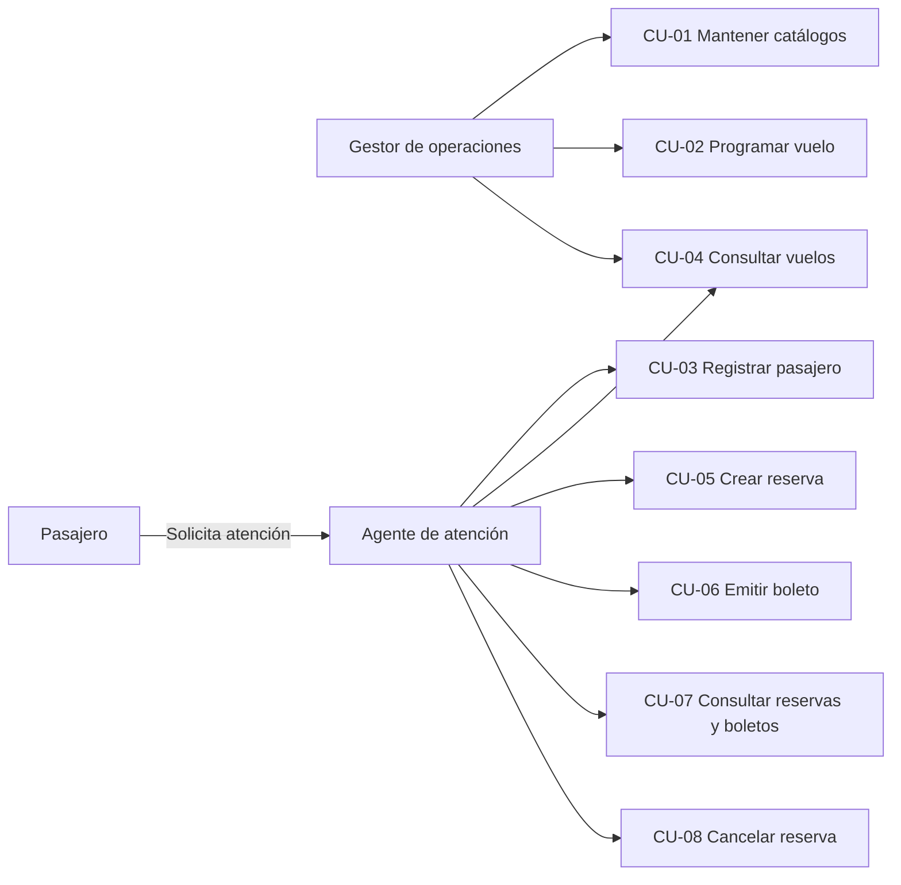
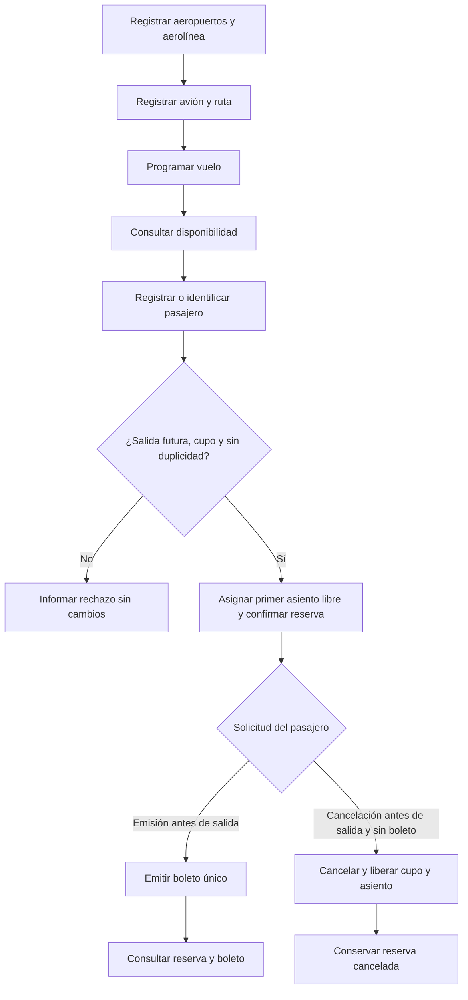

# 02 — Casos de uso y procesos

## Vista de interacciones

El siguiente diagrama es un mapa de casos de uso del negocio expresado en Mermaid, no una representación UML formal. La petición del pasajero se canaliza mediante el agente.

## Especificaciones resumidas

### CU-01 — Mantener catálogos (ACT-01)

**Precondición:** para un avión existe su aerolínea; para una ruta existen sus dos aeropuertos.

1. El gestor elige aeropuerto, aerolínea, avión o ruta y consulta sus registros.
2. Proporciona los datos de un nuevo registro.
3. Se comprueban identidad, datos requeridos y reglas correspondientes.
4. El registro queda disponible para operaciones posteriores.

**Resultado:** registro incorporado con identidad única. **Alternativas:** datos faltantes, identidad repetida, capacidad inválida o ruta inválida causan rechazo sin cambios. No incluye eliminación ni edición de registros.

### CU-02 — Programar vuelo (ACT-01)

**Precondición:** existen ruta y avión con capacidad válida.

1. El gestor selecciona ruta y avión e indica código, salida y llegada.
2. Se comprueba que la salida sea futura, la llegada posterior y el avión esté libre durante todo el intervalo.
3. Se registra el vuelo y se muestra su información.

**Resultado:** vuelo disponible para consultas y reservas. **Alternativas:** código repetido, relación inexistente o incumplimiento temporal rechazan la programación. No se requiere un estado de vuelo: su disponibilidad se deriva del tiempo y de los cupos.

### CU-03 — Registrar pasajero (ACT-02)

**Precondición:** el pasajero facilita sus datos al agente.

1. El agente busca al pasajero por documento.
2. Si no existe, registra documento, nombre y contacto.
3. Se verifica la unicidad y se confirma el registro.

**Resultado:** pasajero disponible para reservas. **Alternativa:** si ya existe, se utiliza ese registro sin duplicarlo. Los datos incompletos causan rechazo.

### CU-04 — Consultar vuelos (ACT-01, ACT-02)

**Precondición:** ninguna; el catálogo puede estar vacío.

1. El actor consulta vuelos programados; puede filtrar por origen y destino.
2. Para buscar disponibilidad, se muestran únicamente vuelos con salida futura y cupos positivos.
3. El actor examina ruta, avión, salida, llegada y cupos restantes.

**Resultado:** listado informativo; la consulta no garantiza un cupo hasta confirmar la reserva. Sin coincidencias se muestra un resultado vacío. Los vuelos pasados siguen siendo consultables en el listado general.

### CU-05 — Crear reserva (ACT-02, a solicitud de ACT-03)

**Precondición:** existen pasajero y vuelo.

1. El agente selecciona pasajero y vuelo.
2. Se verifica salida futura, cupo y ausencia de otra reserva confirmada del mismo pasajero en ese vuelo.
3. Se asigna el menor número de asiento no ocupado por una reserva confirmada del vuelo, entre 1 y la capacidad del avión, y se crea la reserva confirmada con localizador único. La confirmación y la asignación forman una sola operación.
4. Se informa la confirmación, el número de asiento y la disponibilidad actualizada.

**Resultado:** exactamente un cupo y un asiento ocupados. **Alternativas:** falta de cupo/asiento, salida alcanzada o duplicidad rechazan la operación completa. Las comprobaciones se repiten al confirmar aunque una consulta previa mostrara disponibilidad. Las solicitudes concurrentes deben resolverse sin asignar dos veces un asiento del mismo vuelo.

### CU-06 — Emitir boleto (ACT-02)

**Precondición:** existe una reserva confirmada y la salida aún no ha ocurrido.

1. El agente consulta la reserva y solicita la emisión.
2. Se verifica su validez y se comprueba si ya tiene boleto.
3. Se registra el número único y el momento de emisión, o se devuelve el boleto existente. En ambos casos se muestra el asiento obtenido de la reserva; no se asigna otro asiento al emitir.

**Resultado:** un único boleto vinculado a la reserva. No se ocupa un cupo adicional ni cambia el estado de la reserva. Una reserva cancelada o un vuelo cuya salida se alcanzó impiden emitir.

### CU-07 — Consultar reservas y boletos (ACT-02)

**Precondición:** ninguna.

1. El agente busca reservas por localizador, pasajero o vuelo.
2. Consulta su estado y asiento y, si existe, el boleto asociado, también localizable por número. En una reserva cancelada, el asiento se muestra como histórico, sin implicar ocupación actual.

**Resultado:** información consultada sin cambios. La ausencia de registros se informa sin crear datos.

### CU-08 — Cancelar reserva (ACT-02, a solicitud de ACT-03)

**Precondición:** existe una reserva confirmada sin boleto y el vuelo no ha salido.

1. El agente identifica la reserva y solicita cancelarla.
2. Se verifican las condiciones de cancelación.
3. La reserva pasa a cancelada y deja de ocupar cupo y asiento. Conserva el número de asiento como dato histórico, que puede reutilizar otra reserva del mismo vuelo.

**Resultado:** historial conservado y cupo liberado. Repetir la cancelación de una reserva cancelada informa su estado sin liberar otro cupo. Con boleto o salida alcanzada, se rechaza la operación. Una nueva reserva posterior recibe otro localizador.

## Proceso principal de negocio

El proceso presupone que cada alta y programación supera las reglas aplicables. La finalización de un vuelo no requiere una operación de cierre para este alcance.
