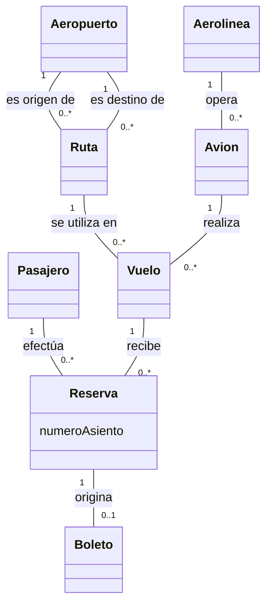

# 04 — Modelo conceptual del negocio

Este modelo describe conceptos y relaciones del dominio. Las propiedades son información del negocio, no EAttributes; las multiplicidades expresan significado, no decisiones de contención EMF. No se introducen claves técnicas ni tipos de programación.

## Conceptos mínimos propuestos

| Concepto | Significado | Información obligatoria del negocio |
|---|---|---|
| Aeropuerto | Lugar de salida o llegada | Código único, nombre, ciudad |
| Aerolínea | Organización que opera aviones | Código único, nombre |
| Avión | Aeronave asignable a vuelos | Matrícula única, capacidad positiva |
| Ruta aérea | Par dirigido de aeropuertos reutilizable en distintos vuelos | Origen y destino; el par identifica la ruta |
| Vuelo | Operación concreta de un avión sobre una ruta | Código de operación único, salida, llegada |
| Pasajero | Persona para quien se registra una reserva | Documento único, nombre completo, contacto |
| Reserva | Compromiso de un cupo y asiento para un pasajero en un vuelo | Localizador único, momento de creación, estado, número de asiento |
| Boleto | Constancia de una reserva confirmada | Número único, momento de emisión |

El código del vuelo identifica una operación concreta y no se reutiliza en otra fecha en este alcance. El documento del pasajero se trata como identificador único de demostración, sin catálogo de países o tipos. El contacto es un dato textual obligatorio; no supone un servicio de envío.

No se duplica la aerolínea en Vuelo ni los aeropuertos en Vuelo: se conocen por Avión y Ruta aérea, respectivamente. No se almacena conceptualmente un contador independiente de cupos: se calcula a partir de las reservas confirmadas.

Los asientos se numeran del 1 a la capacidad de cada avión, sin filas, letras ni clases. El número se asigna automáticamente al reservar y pertenece a Reserva; Boleto lo muestra mediante su reserva, sin duplicarlo como información independiente. No se añade una entidad Asiento ni cambian las relaciones o multiplicidades. Una reserva cancelada conserva el número histórico aunque otra reserva lo ocupe posteriormente; solo las confirmadas bloquean su uso en ese vuelo.

## Relaciones y multiplicidades

| Relación | Desde el primer concepto | Desde el segundo concepto |
|---|---|---|
| Aerolínea opera Avión | Una aerolínea opera 0..* aviones | Un avión pertenece a 1 aerolínea |
| Ruta tiene origen Aeropuerto | Una ruta tiene 1 aeropuerto de origen | Un aeropuerto es origen de 0..* rutas |
| Ruta tiene destino Aeropuerto | Una ruta tiene 1 aeropuerto de destino | Un aeropuerto es destino de 0..* rutas |
| Ruta se utiliza en Vuelo | Una ruta se utiliza en 0..* vuelos | Un vuelo utiliza 1 ruta |
| Avión realiza Vuelo | Un avión realiza 0..* vuelos | Un vuelo utiliza 1 avión |
| Pasajero efectúa Reserva | Un pasajero tiene 0..* reservas | Una reserva pertenece a 1 pasajero |
| Vuelo recibe Reserva | Un vuelo tiene 0..* reservas | Una reserva corresponde a 1 vuelo |
| Reserva origina Boleto | Una reserva tiene 0..1 boleto | Un boleto pertenece a 1 reserva |

Las reservas canceladas permanecen en la relación del vuelo, por lo que su multiplicidad total no se limita a la capacidad. El límite se aplica únicamente a las confirmadas mediante RN-03.

El diagrama usa nombres sin tildes para los nodos y dos asociaciones distintas entre Aeropuerto y Ruta. No expresa composición ni propiedad del ciclo de vida de objetos; esas decisiones pertenecen al PIM.

## Ejemplo coherente para una futura instancia

Datos ficticios, sin pretensión de representar horarios comerciales:

- Aeropuertos CUE (Cuenca) y UIO (Quito); aerolínea ACADEMIA.
- Avión matrícula DEMO-01, capacidad 2, de ACADEMIA.
- Ruta CUE → UIO.
- Vuelo DEMO-001, el 10 de enero de 2030 de 10:00 a 11:00, en una misma zona horaria acordada, con DEMO-01 y esa ruta.
- Pasajeros con documentos ficticios DEMO-P01 y DEMO-P02, nombres y contactos de ejemplo.
- Reserva RES-001 confirmada para DEMO-P01 en DEMO-001, asiento 1; boleto BOL-001 emitido antes de la salida, que muestra ese asiento.
- Reserva RES-002 confirmada para DEMO-P02 en DEMO-001, asiento 2, sin boleto.

El vuelo tiene cero cupos disponibles. Cancelar RES-002 antes de la salida libera un cupo y el asiento 2; el número 2 permanece en su historial. Una nueva reserva recibe automáticamente el asiento 2. RES-001 no puede cancelarse bajo el alcance propuesto. Para ejecutar posteriormente la demostración se elegirá una fecha futura respecto del momento real de la prueba.
